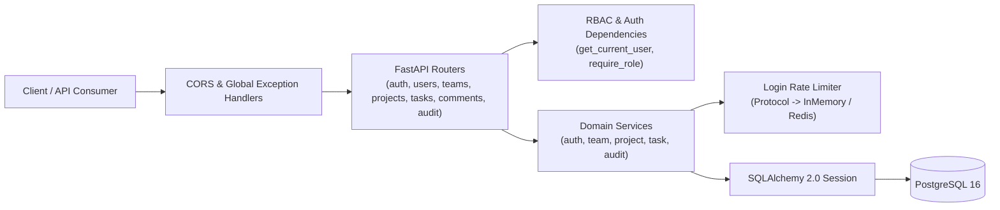

# TaskFlow API — Team Task Management REST API

A production-style, backend-only REST API built with **Python 3.12**, **FastAPI**, **SQLAlchemy 2.0**, **Alembic**, and **PostgreSQL**. Designed as a clean, multi-tenant team workspace (similar to a streamlined Trello/Jira backend) featuring **Argon2id** password hashing, **Refresh Token Rotation with Token Family Reuse Detection**, **Role-Based Access Control (RBAC)** via reusable FastAPI dependencies, sliding-window login rate limiting, and full security audit logging.

## Key Features

- **Production Authentication**:
  - Email normalization and reusable password strength validator (`app/core/password_policy.py`).
  - Short-lived stateless JWT Access Tokens (`15 min`, validated `type="access"` claim) paired with `7-day` opaque Refresh Tokens stored as **SHA-256 hashes** (`refresh_tokens` table).
  - **Refresh Token Rotation & Reuse Detection**: Every `/auth/refresh` call revokes the old token and issues a new pair in the same `family_id`. If a revoked token is replayed, the entire token family is immediately revoked and an `auth.token_reuse_detected` audit log is written.
- **Role-Based Access Control (RBAC)**:
  - Per-team role hierarchy (`owner > admin > member`) enforced via reusable FastAPI dependencies (`get_current_user`, `get_team_membership`, `require_role`).
  - Anti-enumeration security: accessing a team, project, task, or comment belonging to a team the user is not a member of returns **404 Not Found** rather than 403 Forbidden.
  - Strict domain invariants: exactly one owner per team; the owner cannot be removed or demoted; task assignees must belong to the project's team; comments are editable only by their author and deletable by the author or `admin+`.
- **Filtering, Sorting & Pagination**:
  - `GET /projects/{id}/tasks` supports filtering by `status`, `priority`, `assignee`, and `due_before`, sorting by `created_at`, `due_date`, `priority`, `status`, or `title`, and `limit`/`offset` pagination returning `{items, total, limit, offset}`.
- **Security & Reliability**:
  - Sliding-window login rate limiting (`5 failed attempts / 15 minutes` per `IP + email`) returning `429 Too Many Requests` with a `Retry-After` header.
  - Global exception handlers returning a consistent `{"code": "...", "message": "...", "details": ...}` JSON structure without leaking stack traces.
  - Comprehensive `audit_logs` table tracking authentication events, token reuse, and resource/membership mutations.

## Tech Stack

| Layer | Technology |
| :--- | :--- |
| Framework & Validation | FastAPI `0.115.6`, Pydantic v2 (`2.10.4`), `pydantic-settings` |
| ORM & Migrations | SQLAlchemy 2.0 (`Mapped` / `mapped_column`), Alembic `1.14.0` |
| Database | PostgreSQL 16 (`psycopg` v3 driver); SQLite in-memory for isolated tests |
| Security | `PyJWT` (`HS256`), `argon2-cffi` (Argon2id), `hashlib.sha256` |
| Testing & Quality | `pytest`, `httpx` (`TestClient`), `pytest-cov`, `ruff` |
| Containerization | Multi-stage `Dockerfile` (non-root `appuser`), `docker-compose.yml` |

## Architecture Diagram



## Setup Guide (Local & Docker)

### Option A: Run with Docker Compose (Recommended)

```bash
cp .env.example .env
docker compose up --build -d
docker compose logs -f api
```

The API will run Alembic migrations (`alembic upgrade head`) automatically on startup and listen at `http://localhost:8000` (Swagger UI at `http://localhost:8000/docs`).

### Option B: Run Locally with Python `venv`

```bash
python3.12 -m venv .venv
source .venv/bin/activate
pip install --upgrade pip
pip install -r requirements.txt

cp .env.example .env
# Start PostgreSQL container or point DATABASE_URL in .env to your local Postgres instance
alembic upgrade head
uvicorn app.main:app --reload --port 8000
```

## Environment Variables

| Variable | Default in `.env.example` | Description |
| :--- | :--- | :--- |
| `PROJECT_NAME` | `TaskFlow API` | Application title in OpenAPI docs |
| `ENVIRONMENT` | `development` | Runtime environment (`development`, `production`, `test`) |
| `DEBUG` | `false` | Enables verbose debug logging when `true` |
| `DATABASE_URL` | `postgresql+psycopg://...` | SQLAlchemy 2.0 connection URL |
| `JWT_SECRET_KEY` | *(64-char secret)* | Secret key for signing access tokens (min 32 chars enforced) |
| `JWT_ALGORITHM` | `HS256` | HMAC signing algorithm for JWTs |
| `ACCESS_TOKEN_EXPIRE_MINUTES` | `15` | Access token lifetime in minutes |
| `REFRESH_TOKEN_EXPIRE_DAYS` | `7` | Refresh token lifetime in days |
| `LOGIN_RATE_LIMIT_MAX_ATTEMPTS` | `5` | Max failed login attempts per IP+email window |
| `LOGIN_RATE_LIMIT_WINDOW_SECONDS` | `900` | Sliding window duration in seconds (15 minutes) |
| `CORS_ORIGINS` | `http://localhost:3000,...` | Comma-separated list of allowed CORS origins |

## API Endpoints Summary

| Method & Path | Auth / Minimum Role | Description |
| :--- | :--- | :--- |
| `POST /auth/register` | Public | Register user (validates password policy & normalizes email) |
| `POST /auth/login` | Public (Rate-limited) | Authenticate and receive `access_token` + `refresh_token` |
| `POST /auth/refresh` | Public (Refresh Token) | Rotate refresh token; revokes token family on reuse |
| `POST /auth/logout` | Public (Refresh Token) | Revoke the provided refresh token |
| `GET /users/me` | Authenticated User | Return current user's profile |
| `POST /teams` | Authenticated User | Create a team (creator becomes `owner`) |
| `GET /teams` | Authenticated User | List teams the current user belongs to |
| `GET /teams/{team_id}` | Team `member+` | Get team details (`404` if not a member) |
| `DELETE /teams/{team_id}` | Team `owner` | Delete team and cascade child projects/tasks |
| `POST /teams/{team_id}/members` | Team `admin+` | Add user to team (`owner` required to add as `admin`) |
| `PATCH /teams/{team_id}/members/{user_id}` | Team `owner` | Change member role (`owner` cannot be demoted) |
| `DELETE /teams/{team_id}/members/{user_id}` | Team `admin+` | Remove member (`owner` cannot be removed) |
| `POST /teams/{team_id}/projects` | Team `member+` | Create project in team |
| `GET /teams/{team_id}/projects` | Team `member+` | List projects in team |
| `GET /projects/{project_id}` | Team `member+` | Get project (`404` if not in team) |
| `PATCH /projects/{project_id}` | Team `member+` | Update project name/description |
| `DELETE /projects/{project_id}` | Team `admin+` | Delete project |
| `POST /projects/{project_id}/tasks` | Team `member+` | Create task (assignee must belong to team) |
| `GET /projects/{project_id}/tasks` | Team `member+` | Filter, sort, and paginate tasks |
| `GET /tasks/{task_id}` | Team `member+` | Get task details |
| `PATCH /tasks/{task_id}` | Team `member+` | Update task fields |
| `DELETE /tasks/{task_id}` | Team `member+` | Delete task |
| `POST /tasks/{task_id}/comments` | Team `member+` | Add comment to task |
| `GET /tasks/{task_id}/comments` | Team `member+` | List task comments chronologically |
| `PATCH /comments/{comment_id}` | Comment Author | Edit own comment |
| `DELETE /comments/{comment_id}` | Author or `admin+` | Delete comment |
| `GET /teams/{team_id}/audit-logs` | Team `admin+` | View paginated, filterable team audit logs |
| `GET /health` | Public | Liveness and PostgreSQL connectivity check |

## Authentication & Refresh Rotation Flow

1. **Login (`POST /auth/login`)**: Verifies password with Argon2id. Generates a 15-minute JWT (`type="access"`) and a 48-byte random refresh token. Only the `SHA-256` hash of the refresh token is saved in PostgreSQL with a new UUID `family_id`.
2. **Rotation (`POST /auth/refresh`)**: Looks up the SHA-256 hash. Marks the current row `revoked = True` and issues a brand-new access + refresh token pair sharing the same `family_id`.
3. **Reuse Detection**: If an already-revoked refresh token is submitted again (indicating token theft), the server executes `UPDATE refresh_tokens SET revoked = True WHERE family_id = :family_id`, writes an `auth.token_reuse_detected` audit log, and returns `401 Unauthorized`, forcing both the attacker and legitimate user to log in again.

## Running Tests & Linting

```bash
# Run pytest with coverage report
pytest --cov=app --cov-report=term-missing

# Run Ruff linter and formatter check
ruff check .
ruff format --check .
```

## Example `curl` Requests

```bash
# 1. Register a user
curl -X POST http://localhost:8000/auth/register \
  -H "Content-Type: application/json" \
  -d '{"email": "rahul@example.com", "full_name": "Rahul Sharma", "password": "StrongPass1!"}'

# 2. Log in and capture tokens
curl -X POST http://localhost:8000/auth/login \
  -H "Content-Type: application/json" \
  -d '{"email": "rahul@example.com", "password": "StrongPass1!"}'

# 3. Create a team
curl -X POST http://localhost:8000/teams \
  -H "Authorization: Bearer <ACCESS_TOKEN>" \
  -H "Content-Type: application/json" \
  -d '{"name": "Core Backend Team"}'

# 4. Create a project and filter tasks
curl -X GET "http://localhost:8000/projects/1/tasks?status=in_progress&priority=high&limit=10&offset=0" \
  -H "Authorization: Bearer <ACCESS_TOKEN>"
```

## Design Decisions & Security Trade-offs

1. **Synchronous SQLAlchemy 2.0 over Async**: Keeps stack traces clean, avoids `MissingGreenlet` lazy-loading traps, and pairs well with standard `psycopg` v3 connection pooling.
2. **Stateless Access JWTs vs. Stateful Refresh Tokens**: Access tokens are verified without a DB query on every request (though `get_current_user` checks `user.is_active`), while refresh tokens are stored hashed in PostgreSQL so sessions can be revoked immediately on logout or compromise.
3. **In-Memory Rate Limiter Trade-off**: `InMemoryLoginRateLimiter` is zero-dependency for single-container deployments, but state is per-process. `RateLimiterBackend` is defined as a `Protocol` so a Redis `ZSET` implementation can be injected when scaling horizontally across multiple Uvicorn workers.

## Deployment Guide (Render / Railway)

1. Push this repository to GitHub.
2. Create a managed **PostgreSQL** service in Render or Railway and copy its internal `DATABASE_URL` (ensure the scheme is `postgresql+psycopg://...`).
3. Create a **Web Service** pointing to the repo's `Dockerfile`.
4. Set environment variables (`DATABASE_URL`, `JWT_SECRET_KEY` generated via `openssl rand -hex 32`, `ENVIRONMENT=production`, `CORS_ORIGINS`).
5. Configure the health check path to `/health`. The container's `CMD` automatically runs `alembic upgrade head` before starting `uvicorn`.
